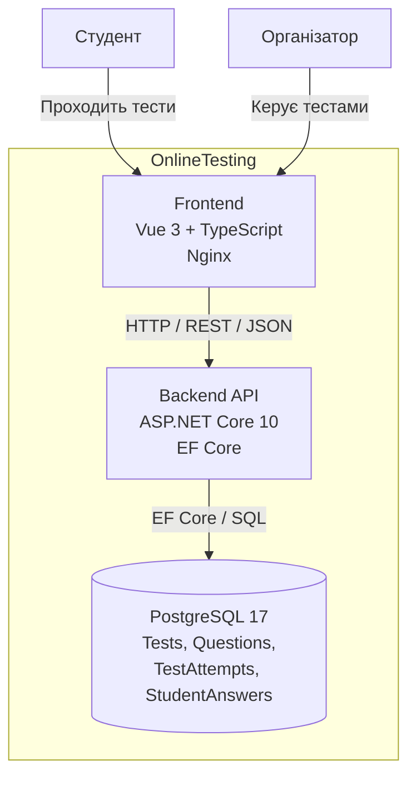
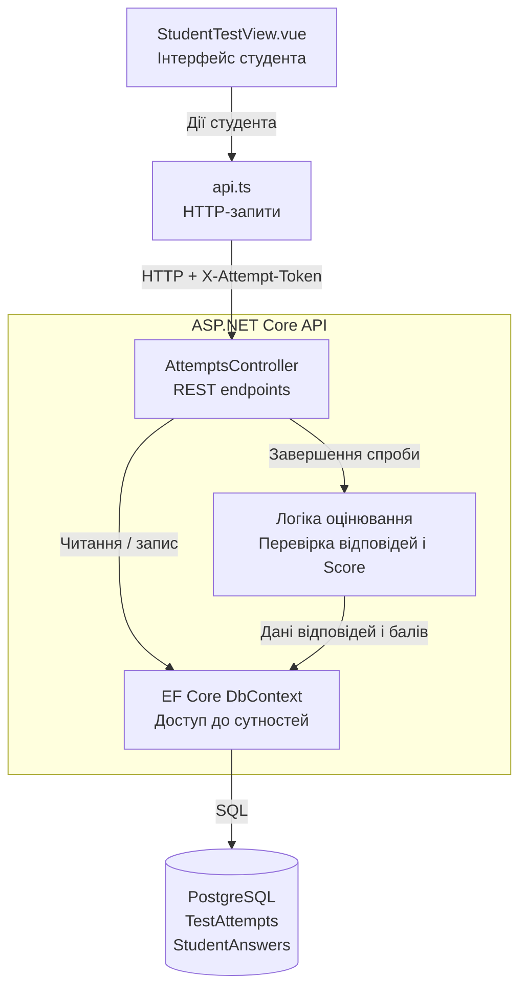
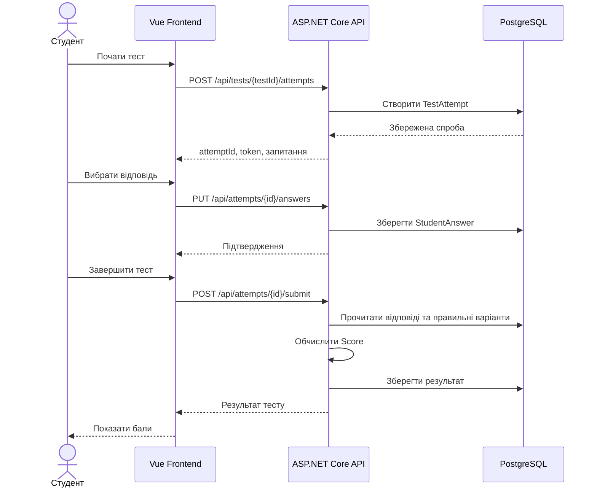

# Архітектура OnlineTesting

## 1. Загальний опис

OnlineTesting — вебсистема для створення та проходження онлайн-тестів.

Система складається з трьох основних контейнерів:
- Frontend — Vue 3 + TypeScript.
- Backend API — ASP.NET Core 10.
- Database — PostgreSQL 17.

Усі компоненти можуть запускатися за допомогою Docker Compose.

## 2. C4 Container Diagram



### Пояснення

**Frontend** відображає інтерфейс користувача та надсилає HTTP-запити до API.

**Backend API** обробляє бізнес-логіку: керування тестами, створення спроб, збереження відповідей та обчислення результатів.

**PostgreSQL** зберігає тести, запитання, варіанти відповідей, спроби проходження та відповіді студентів.

Nginx обслуговує frontend і передає запити `/api/` до backend-контейнера.

## 3. C4 Component Diagram — модуль проходження тестів



### Компоненти модуля учасника №2

**StudentTestView.vue** — інтерфейс проходження тесту, вибору відповідей і перегляду результату.

**api.ts** — клієнтські функції для звернення до REST API.

**AttemptsController** — створення спроб, перевірка токенів, збереження відповідей, завершення тестування та отримання результатів.

**Логіка оцінювання** — обчислення набраних балів за правильними відповідями. Це логічний компонент усередині backend, а не обов'язково окремий клас.

**EF Core DbContext** — доступ до таблиць PostgreSQL через сутності.

## 4. Основний сценарій взаємодії



## 5. Розгортання

Для запуску використовується команда:

```powershell
docker compose up -d --build
```

Основні адреси:
- Frontend: `http://localhost:8081`
- Backend API: `http://localhost:8080`
- PostgreSQL: `localhost:5432`

Контейнери використовують спільну Docker-мережу `testing-network`.

Дані PostgreSQL зберігаються в Docker volume `postgres_data`.

## 6. Архітектурні рішення

1. **Поділ frontend і backend.** Дозволяє незалежно розробляти інтерфейс і серверну логіку.
2. **REST API.** Забезпечує зрозумілу взаємодію через HTTP та JSON.
3. **Entity Framework Core.** Спрощує роботу з даними та підтримує міграції структури БД.
4. **PostgreSQL.** Забезпечує реляційне зберігання пов'язаних сутностей.
5. **Docker Compose.** Дозволяє відтворити середовище запуску однією командою.
6. **Токен доступу до спроби.** Обмежує доступ до відповідей і результатів конкретної спроби.

## 7. Відповідальність учасника №2

Учасник №2 відповідає за компонент проходження тестів, включно з REST endpoints, сутностями TestAttempt і StudentAnswer, логікою оцінювання, студентським інтерфейсом та перевіркою інтеграції з базою даних.

Інші компоненти системи відображені на загальній діаграмі для розуміння взаємодії між модулями.
