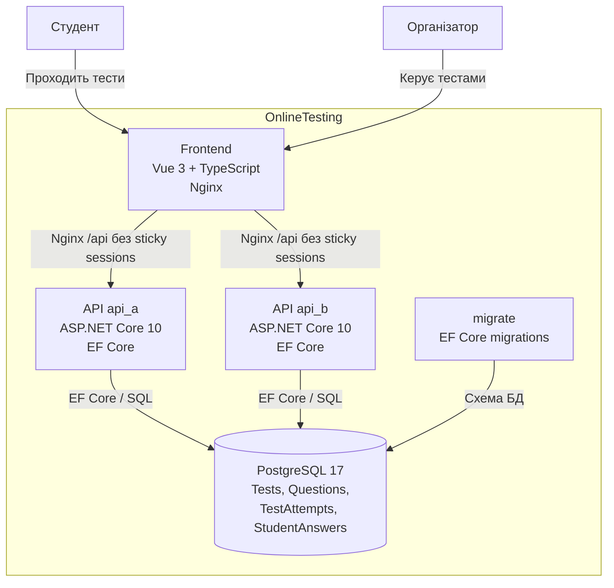
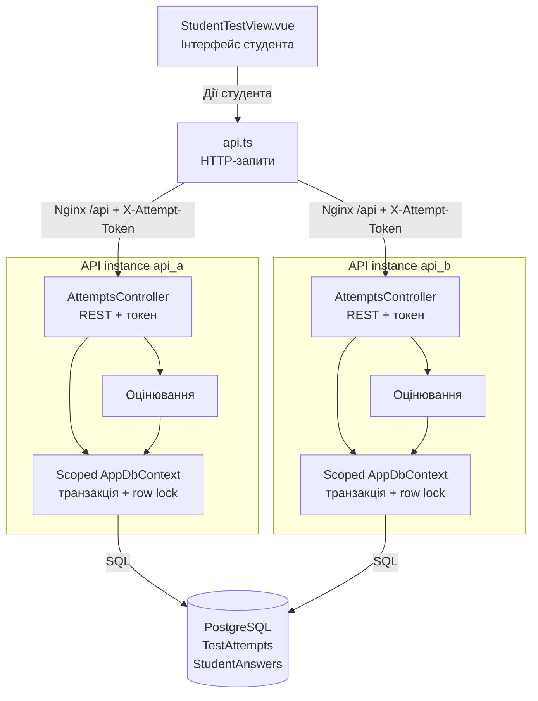
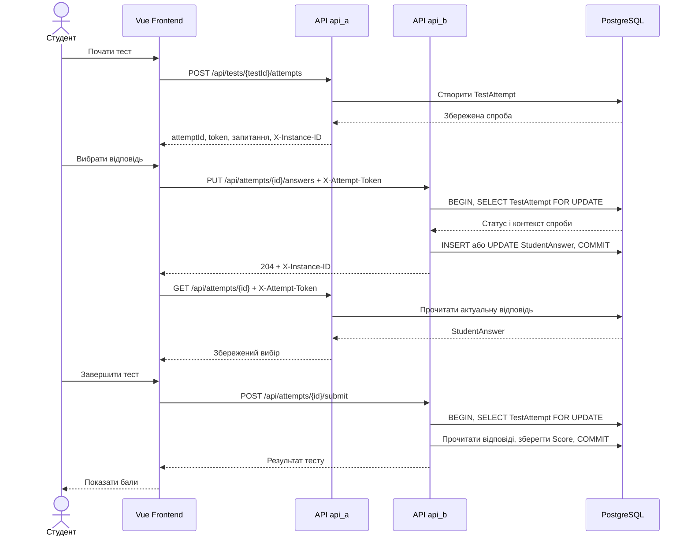

# Архітектура OnlineTesting

## 1. Загальний опис

OnlineTesting — вебсистема для створення та проходження онлайн-тестів.

Система складається з frontend, двох однакових API-контейнерів, одноразового контейнера міграцій та PostgreSQL:
- Frontend — Vue 3 + TypeScript.
- Backend API — ASP.NET Core 10, вузли `api_a` і `api_b`.
- Migration — застосування EF Core міграцій перед стартом API.
- Database — PostgreSQL 17.

Усі компоненти можуть запускатися за допомогою Docker Compose.

## 2. C4 Container Diagram



### Пояснення

**Frontend** відображає інтерфейс користувача та надсилає HTTP-запити до API.

**Backend API** обробляє бізнес-логіку на двох взаємозамінних вузлах. Кожен вузол повертає заголовок `X-Instance-ID`.

**PostgreSQL** зберігає тести, запитання, варіанти відповідей, спроби проходження та відповіді студентів.

Nginx обслуговує frontend і розподіляє запити `/api/` між `api_a` та `api_b`. Обидва вузли використовують одну БД.

## 3. C4 Component Diagram — модуль проходження тестів



### Компоненти модуля учасника №2

**StudentTestView.vue** — інтерфейс проходження тесту, вибору відповідей і перегляду результату.

**api.ts** — клієнтські функції для звернення до REST API.

**AttemptsController** — створення спроб, перевірка токенів, збереження відповідей, завершення тестування та отримання результатів.

**Логіка оцінювання** — обчислення набраних балів за правильними відповідями. Це логічний компонент усередині backend, а не обов'язково окремий клас.

**EF Core DbContext** — доступ до таблиць PostgreSQL через сутності.

## 4. Основний сценарій взаємодії



## 5. Розгортання

Для запуску використовується команда:

```powershell
docker compose up -d --build
```

Основні адреси:
- Frontend: `http://localhost:8081`
- Backend API: `http://localhost:8080`
- Другий API-вузол: `http://localhost:8082`
- PostgreSQL: `localhost:5432`

Контейнери використовують спільну Docker-мережу `testing-network`.

Дані PostgreSQL зберігаються в Docker volume `postgres_data`.

## 6. Архітектурні рішення

1. **Два stateless API-вузли.** Вузол не зберігає бізнес-стан між запитами; кожен запит може обробити довільний вузол.
2. **REST API.** Забезпечує зрозумілу взаємодію через HTTP та JSON.
3. **Entity Framework Core.** Спрощує роботу з даними та підтримує міграції структури БД.
4. **PostgreSQL.** Забезпечує реляційне зберігання пов'язаних сутностей.
5. **Docker Compose.** Дозволяє відтворити середовище запуску однією командою.
6. **Токен доступу до спроби.** Обмежує доступ до відповідей і результатів конкретної спроби.
7. **Транзакції та row lock PostgreSQL.** Узгоджують збереження відповіді й завершення спроби між процесами та забезпечують rollback незавершеної операції при втраті вузла.

## 7. Розподіл роботи лабораторної 2

Учасник А виконав аудит стану та забезпечив узгоджене збереження відповідей і завершення спроб через транзакції та блокування рядка в PostgreSQL (пункти 2.1–2.3).

Учасник Б додав два API-вузли, ідентифікацію `X-Instance-ID`, балансування Nginx, сценарій втрати вузла та оновив архітектурні схеми (пункти 2.4–2.6). Усі компоненти вже об'єднано в поточній конфігурації.
