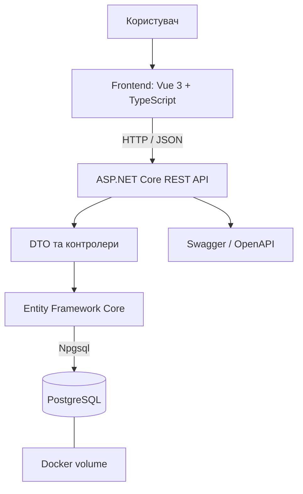

# Архітектура системи OnlineTesting

## 1. Загальна архітектура

Система побудована за клієнт-серверною архітектурою. Frontend відповідає за інтерфейс користувача, backend реалізує REST API та бізнес-логіку, PostgreSQL зберігає дані.

## 2. Компоненти

### Frontend
Vue 3 і TypeScript використовуються для побудови інтерфейсу керування тестами, запитаннями та варіантами відповідей. Vue Router відповідає за маршрутизацію, Pinia доступна для керування станом. HTTP-запити виконуються через Fetch API.

### Backend
ASP.NET Core Web API обробляє HTTP-запити. Контролери приймають запити, перевіряють вхідні дані, викликають операції Entity Framework Core та повертають DTO у форматі JSON.

### Рівень доступу до даних
Entity Framework Core виконує запити до PostgreSQL через провайдер Npgsql. `AppDbContext` описує таблиці та зв'язки між сутностями.

### База даних
PostgreSQL зберігає тести, запитання та варіанти відповідей. Docker volume використовується для збереження даних між перезапусками контейнера бази даних.

## 3. Схема взаємодії

## 4. Основний сценарій запиту

1. Користувач виконує дію в інтерфейсі.
2. Frontend надсилає HTTP-запит до відповідного endpoint.
3. Контролер backend обробляє запит і перевіряє вхідні дані.
4. Entity Framework Core виконує операцію з PostgreSQL.
5. API повертає HTTP-статус і, за потреби, JSON-відповідь.
6. Frontend оновлює відображення даних.

## 5. Розгортання

Docker Compose запускає API та PostgreSQL як окремі сервіси. API доступний на локальному порту 8080, PostgreSQL — на порту 5432. Усередині Docker-мережі API звертається до бази даних за ім'ям сервісу `db`.

Параметри підключення задаються конфігурацією середовища. Паролі не повинні зберігатися у відкритому вигляді в репозиторії. Для локального запуску використовується файл `.env`, який має бути виключений із Git, а `.env.example` містить лише приклад параметрів без реальних секретів.

## 6. Перевірка працездатності

- `GET /health` — перевірка доступності API.
- Swagger UI — інтерактивна документація REST API.
- `npm run build` — перевірка типів і production-збірка frontend.
- `dotnet build backend/OnlineTesting.Api` — компіляція backend.
