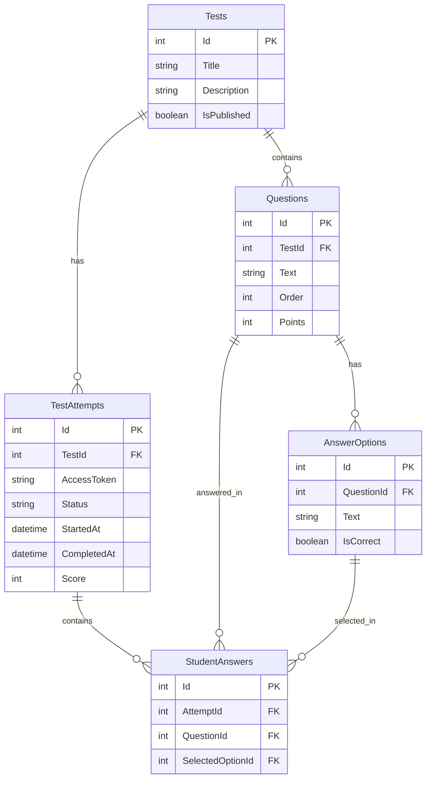

# ER-діаграма OnlineTesting

## Доменна модель

Система містить п'ять основних сутностей:

- Test — тест, створений організатором.
- Question — запитання тесту.
- AnswerOption — можливий варіант відповіді.
- TestAttempt — спроба проходження тесту студентом.
- StudentAnswer — відповідь студента на запитання.

## ER Diagram

## Зв'язки між сутностями

| Зв'язок | Кардинальність | Опис |
|---|---|---|
| Test → Question | 1:N | Один тест містить багато запитань |
| Question → AnswerOption | 1:N | Одне запитання має багато варіантів |
| Test → TestAttempt | 1:N | Один тест може мати багато спроб |
| TestAttempt → StudentAnswer | 1:N | Одна спроба містить відповіді |
| Question → StudentAnswer | 1:N | На запитання можуть відповідати в різних спробах |
| AnswerOption → StudentAnswer | 1:N | Один варіант може бути обраний у багатьох спробах |

## Відповідальність учасника №2

Учасник №2 реалізував:

- TestAttempt — зберігання спроб тестування.
- StudentAnswer — зберігання відповідей студентів.
- REST API для проходження тестів.
- Автоматичне обчислення результатів.

Сутності Tests, Questions та AnswerOptions використовуються як залежності модуля проходження тестів.
## Документація модуля учасника №2

- [ER-діаграма бази даних](docs/er-diagram.md)
- [Модуль проходження тестів](docs/student-module.md)
- [Архітектура системи](docs/architecture.md)