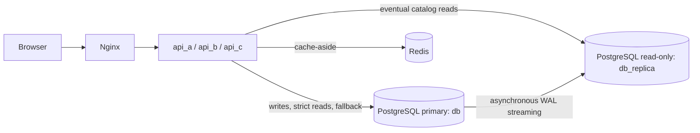

# Lab 6 — топологія PostgreSQL

Міграції EF Core й усі транзакції виконуються на primary. Replica обслуговує каталог і список запитань. `ReplicaReadService` виконує fallback до primary при недоступності replica. Критичні читання залишаються на primary, щоб забезпечити read-after-write. Автоматичний promotion replica не налаштовано, тому при втраті primary записи блокуються, а eventual reads залишаються доступними.
