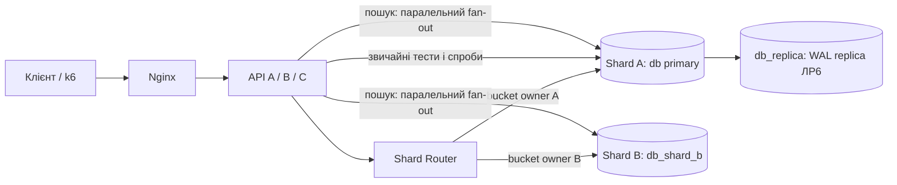

# Lab 7 — шардинг журналу подій спроб

## Обраний dataset і межа змін

`lab7_events` — окремий журнал подій спроб тестування. Запис містить `student_id`, `attempt_id`, `event_id`, тип події, короткий payload і час. Це ресурсомісткий append-heavy набір даних, який зростає разом із кількістю проходжень. ЛР7 використовує окремий API `/api/lab7/events`; основні таблиці `TestAttempts` і `StudentAnswers` залишаються в primary ЛР6. Журнал демонстраційний і не є джерелом оцінок або авторизації.

Сурогатний глобальний автоінкрементний ID не визначає місце подій конкретної спроби. Ключ `student_id + attempt_id` зберігає її події локально, має вищу cardinality, ніж лише `student_id`, і розподіляє багато спроб «гарячого» студента. `event_id` — UUID, який уникaє централізованого генератора ID; унікальність забезпечується композитним PK локально на шарді. Однаковий `student_id + attempt_id` завжди маршрутизується на той самий шард.



Shard A є чинним `db`, тож старі дані та репліка ЛР6 збережені. Shard B — окремий PostgreSQL-контейнер із власним volume. Таблиця журналу створюється ідемпотентним `lab7_init` на обох шардах. API отримує адреси шардів із `ConnectionStrings__ShardAConnection` і `ConnectionStrings__ShardBConnection`. Redis не кешує цей журнал, щоб вимірювати роботу БД.

## Маршрутизатор і операції

- `single`: всі події йдуть на A. Це контрольна топологія для benchmark.
- `legacy`: `SHA256(student_id) % 2`. Один активний студент спрямовує всі записи на один шард.
- `bucket`: `SHA256(student_id + ':' + attempt_id) % 64` вибирає віртуальний кошик. Власник кошика — вузол із найбільшим rendezvous hash score серед A і B. Всі CRUD-операції для одного ключа обчислюють той самий шлях.
- `GET /api/lab7/events/local` читає один шард. `GET /api/lab7/events/search` запускає запит до обох шардiв паралельно, потім зливає й сортує відповіді; `distribution` читає фізичні лічильники обох БД.

Поле `strategy` є частиною PK, тому лабораторні режими не змішують записи. Змінювати стратегію для вже створених даних без міграції не можна: відповідний об'єкт стане недоступним за новим маршрутом.

## Hot shard, транзакції та решардинг

Генератор створює 90% подій для `hot-student`. `legacy` зосереджує їх на одному шарді, `bucket` розподіляє різні спроби цього студента між шардами. Усі події **однієї** спроби лишаються разом; якщо гарячою стає одна окрема спроба, потрібен дрібніший ключ і зміна запитів. Звіт фіксує фактичні записи, p95/p99 та зразки CPU/RAM; поліпшення latency не припускається без вимірювання.

Локальна транзакція PostgreSQL поширюється тільки на один шард. Мутація основної спроби та журналу на іншому шарді може частково завершитися; звичайний `BEGIN/COMMIT` цього не вирішує. Для реальної інтеграції потрібен transactional outbox у primary і асинхронний споживач із ідемпотентним `event_id` та компенсацією (Saga), або 2PC із додатковою складністю й ризиком блокування. У цій лабораторній демонстраційний журнал не підключено до критичних транзакцій оцінювання. Глобальний JOIN по всіх студентах та глобальну унікальність за одним лише `event_id` БД автоматично не гарантує; fan-out і злиття виконує застосунок.

Модель `scripts/lab7-reshard-model.ps1` порівнює перехід 2 → 3: `hash(key) % N` та 64 virtual buckets із rendezvous ownership. Наївне modulo переносить приблизно 2/3 ключів для переходу 2 → 3 (не 100%); новий вузол у consistent hashing отримує близько 1/3. Модель **не** переміщує живі записи. Практичне розширення потребує версії карти кошиків, копіювання даних, checksum, переключення маршруту й плану відкату.

Партиціювання розділяє дані на секції всередині однієї логічної БД; шардинг розміщує їх на незалежних вузлах; реплікація копіює ті самі дані на інший вузол. Ця лабораторна використовує фізичний шардинг журналу та зберігає WAL-реплікацію Shard A з ЛР6.

## Запуск і захист

```powershell
docker compose up -d --build
pwsh -NoProfile -File scripts/verify-lab7.ps1
pwsh -NoProfile -File load-tests/run-lab7.ps1 -Smoke
pwsh -NoProfile -File load-tests/run-lab7.ps1 -StageSeconds 15
```

Показати `docker compose ps`, маршрут `GET /api/lab7/events/route`, фізичні `count(*)` на A/B, CRUD, розподіл `legacy`/`bucket`, локальний і fan-out запити, графіки та модель 2 → 3 у [звіті](lab7-results/report.md). Скрипт benchmark використовує вже встановлений образ `grafana/k6:1.5.0` або Docker автоматично завантажує його; Grafana UI не потрібен.
