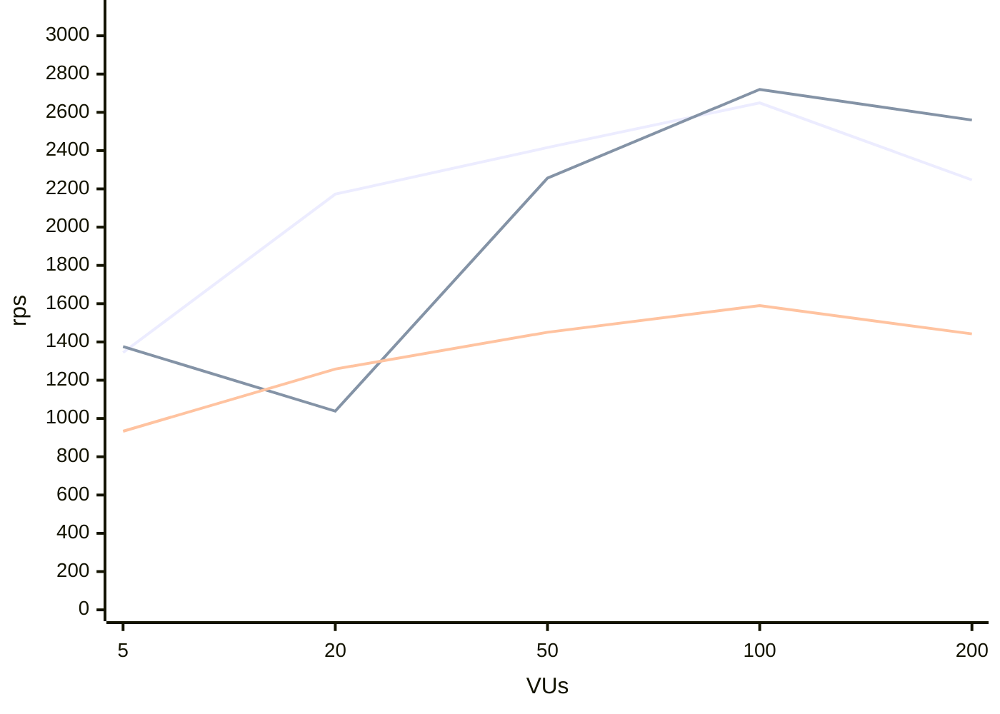

# Lab 7 — результати масштабування даних

Вимірювання виконано через той самий Nginx і k6 у Docker (генератор: 1 CPU, 512 MiB). `single` пише лише на Shard A; `legacy` маршрутизує за studentId; `bucket` — за studentId+attemptId через 64 віртуальні кошики та rendezvous ownership. Відсотки записів у таблиці нижче рахуються за фактичними приростами записів у двох фізичних БД.
Кожен режим читання використовує ті самі 300 тестових подій на стратегію з типом lab7-seed-206aac83083f46648306b43bc5fccc05; старі події не потрапляють до результатів пошуку.

## Базовий розподіл даних

| Стратегія | Шард | Записи | Частка даних | Частка операцій запису |
|---|---|---:|---:|---:|
| single | shard-a | 300 | 100% | 100% |
| single | shard-b | 0 | 0% | 0% |
| legacy | shard-a | 279 | 93% | 93% |
| legacy | shard-b | 21 | 7% | 7% |
| bucket | shard-a | 162 | 54% | 54% |
| bucket | shard-b | 138 | 46% | 46% |

## Порівняння читання

| Топологія / запит | VUs | RPS | p95, мс | p99, мс | Помилки, % | Невдалі перевірки |
|---|---:|---:|---:|---:|---:|---:|
| single-local | 5 | 1344.72 | 4.8 | 6.6 | 0 | 0 |
| sharded-local | 5 | 1375.72 | 4.51 | 6.09 | 0 | 0 |
| fanout | 5 | 933.36 | 7.6 | 11.24 | 0 | 0 |
| single-local | 20 | 2172.43 | 24.07 | 35.32 | 0 | 0 |
| sharded-local | 20 | 1038.4 | 19.58 | 32.33 | 0.0032 | 1 |
| fanout | 20 | 1258.56 | 29.1 | 42.02 | 0 | 0 |
| single-local | 50 | 2415.9 | 46.48 | 58.67 | 0 | 0 |
| sharded-local | 50 | 2256.28 | 45.98 | 58.85 | 0 | 0 |
| fanout | 50 | 1450.46 | 59.79 | 81.85 | 0 | 0 |
| single-local | 100 | 2649.37 | 74.98 | 101.96 | 0 | 0 |
| sharded-local | 100 | 2719.75 | 73.84 | 100.51 | 0 | 0 |
| fanout | 100 | 1590.05 | 102.52 | 147.31 | 0 | 0 |
| single-local | 200 | 2246.77 | 192.88 | 286.17 | 0 | 0 |
| sharded-local | 200 | 2559.67 | 154.38 | 208.99 | 0 | 0 |
| fanout | 200 | 1442.16 | 251.04 | 339.61 | 0 | 0 |

Локальний запит шукає події однієї спроби на одному шарді; fan-out одночасно звертається до двох шардів, зливає результати і сортує їх. Це різні профілі запиту, тому RPS порівнює їхню фактичну вартість, а не лише швидкість вузлів.

### rps за кількістю VUs


Лінії в порядку: single-local, sharded-local, fanout.

### p99Ms за кількістю VUs

```mermaid
xychart-beta
  x-axis VUs [5, 20, 50, 100, 200]
  y-axis p99Ms 0 --> 391
  line [6.6, 35.32, 58.67, 101.96, 286.17]
  line [6.09, 32.33, 58.85, 100.51, 208.99]
  line [11.24, 42.02, 81.85, 147.31, 339.61]
```
Лінії в порядку: single-local, sharded-local, fanout.

## Сценарій гарячого шарду

| Стратегія | VUs | Шард A: записи | Шард B: записи | RPS | p95, мс | p99, мс | Найвищий зразок CPU/RAM A | Найвищий зразок CPU/RAM B |
|---|---:|---:|---:|---:|---:|---:|---|---|
| legacy | 5 | 5258 | 109 | 354.6 | 31.37 | 110.5 | 72.71% CPU; 157.2MiB RAM | 8.08% CPU; 150.6MiB RAM |
| legacy | 50 | 24627 | 1377 | 1730.13 | 53.22 | 145.76 | 145.07% CPU; 152.5MiB RAM | 9.1% CPU; 132.2MiB RAM |
| bucket | 5 | 5718 | 4880 | 706.22 | 10.93 | 16.01 | 51.63% CPU; 160.7MiB RAM | 25.67% CPU; 102MiB RAM |
| bucket | 50 | 15754 | 13510 | 1946.57 | 42.79 | 59.28 | 79.99% CPU; 171.2MiB RAM | 74.64% CPU; 123.4MiB RAM |

Порівняння 5 і 50 VUs показує стрибок хвостової затримки під навантаженням. При 50 VUs перехід до складеного ключа змінив p99 з 145,76 на 59,28 мс, а RPS — з 1730,13 на 1946,57. Це вимірювання одного Docker-хоста, не гарантія такого самого приросту в іншому середовищі. CPU/RAM — зразки `docker stats` під час тесту; вони не є точними піками.

## Модель 2 → 3 шарди

Для 10000 ключів простий hash(key) % N переміщує 6750 записів (67.5%). За 64 віртуальними кошиками й rendezvous ownership змінюють власника 22 кошиків, або 3384 записів (33.84%). Теоретична частка нового вузла — близько 33.33%. Це **модель плану міграції**, а не виконана жива міграція: перед додаванням Shard C потрібні копіювання даних кошиків, перевірка checksum, переключення карти й контроль відкату.

## Межа насичення і обмеження

- single-local: ознаки насичення між 100 і 200 VUs.
- sharded-local: ознаки насичення між 100 і 200 VUs.
- fanout: ознаки насичення між 100 і 200 VUs.

Первинна БД ЛР6 одночасно є Shard A; його репліка не збільшує пропускну здатність записів. Глобальні JOIN і UNIQUE між шардами не забезпечуються локальними обмеженнями. Події журналу не беруть участі в транзакції основної спроби; для спільного запису потрібен outbox/Saga або 2PC.
