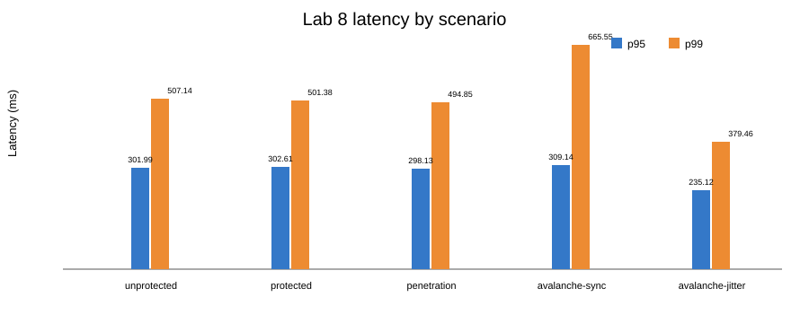

# Lab 8 — Resilience Engineering

Дата прогону: 2026-11-24 23:15. Контрольний режим: 500 VUs; тривалість 30 с на сценарій. DB loads — контрольні лічильники SQL-завантажень PostgreSQL, збережені у Redis.

| Режим | VUs | HTTP requests | RPS | p95 ms | p99 ms | HTTP errors % | Failed checks | Resource DB loads | Missing entity DB loads | Avalanche DB loads |
|---|---:|---:|---:|---:|---:|---:|---:|---:|---:|---:|
| unprotected | 500 | 115142 | 3825.68 | 301.99 | 507.14 | 0 | 0 | 500 | 0 | 0 |
| protected | 500 | 115439 | 3822.92 | 302.61 | 501.38 | 0 | 0 | 1 | 0 | 0 |
| penetration | 500 | 120050 | 3988.26 | 298.13 | 494.85 | 0 | 0 | 0 | 95 | 0 |
| avalanche-sync | 500 | 118738 | 3954.85 | 309.14 | 665.55 | 0 | 0 | 0 | 0 | 37181 |
| avalanche-jitter | 500 | 129266 | 4299.37 | 235.12 | 379.46 | 0 | 0 | 0 | 0 | 34209 |

## Analysis

При одночасному MISS режим unprotected допускає паралельні завантаження. Protected використовує Redis SET NX lock з випадковим token, повторне читання кешу та compare-and-delete під час звільнення блокування. Порівняння за цим запуском: resource DB loads 500 → 1; RPS 3825.68 → 3822.92; p99 507.14 → 501.38 ms.

Avalanche: синхронний TTL спричинив 37181 контрольних завантажень джерела, TTL jitter — 34209, зменшення на 8%. p99 змінився з 665.55 до 379.46 ms (зменшення на 43%).
Negative caching: за 500 VUs і 30 секунд було 95 SQL-запитів для неіснуючого ID з 120050 HTTP-запитів (0.079%); у лічильник входить початкова холодна хвиля.

Negative cache зберігає маркер відсутності 15 секунд. TTL основного ресурсу має базу 30 секунд і рівномірний jitter ±10 секунд; endpoint повертає вибраний TTL у `X-Cache-TTL-Seconds`.

## Failure modes та компроміси

- Redis недоступний: блокування недоступне, сервіс переходить до БД без координації; це може спричинити herd.
- Lock має TTL 15 секунд; якщо обчислення триває довше, інший вузол може отримати lock. Для довгих задач треба продовження lease/fencing token.
- Очікування coalesced запиту обмежене 2 секундами; після timeout запит може піти до БД.
- Negative cache на 15 секунд затримує появу щойно створеної сутності; запис має інвалідовувати відповідний negative key у production.
- TTL jitter зменшує синхронне expiration, але не прибирає stampede для одного надзвичайно популярного ключа.
- Лічильники підтверджують спроби SQL-завантаження у контрольних endpoint-ах; production потребує моніторингу PostgreSQL і Redis.

## Обмеження

Порівнюйте режими на однаковій машині та однаковій тривалості. Smoke є лише перевіркою й може не дочекатися TTL expiry. Для порівняння 500 VUs запустіть `pwsh -NoProfile -File load-tests/run-lab8.ps1 -StageSeconds 30`.

## Latency graph

